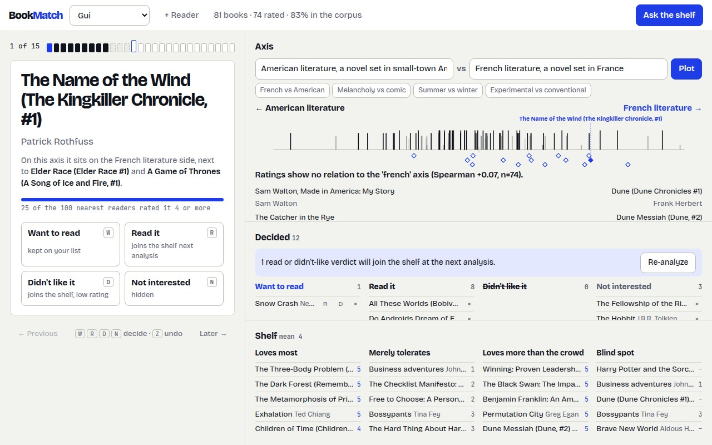

# Book Match

[](https://github.com/cptntrps/bookmatch/actions/workflows/tests.yml)
[](LICENSE)

A taste engine for one person's library. Point it at a Goodreads shelf and it builds
a taste profile from embeddings, finds the books that readers nearest to this person
love and they do not own yet (user-based collaborative filtering over 876k public
readers), and hands both to a chat agent that can rank the shelf and the candidates
along any concept you name in conversation: "more French", "less violent",
"something for summer". No labels, no training, one dot product per book.

The conversational concept-axis method is written up in [METHOD.md](METHOD.md).
The design record is [DESIGN.md](DESIGN.md).

## The demo

An axis built only from the phrases "French literature" vs "American literature",
applied to a real 309-book shelf (`tests/reader_a_books.json`, an anonymized public
Goodreads shelf). Nobody labelled which books are French.

```
python -m bookmatch.cli tests/reader_a_books.json \
    --positive "French literature" "a novel set in France" "French author" \
    --negative "American literature" "a novel set in small-town America" "American author" \
    --label french --candidates candidates.json --top 8
```

```
axis 'french'

toward the positive pole:
  The Margot Affair — Sanaë Lemoine
  The Lover — Marguerite Duras
  Perfume: The Story of a Murderer — Patrick Süskind
  Hiroshima mon amour — Marguerite Duras
  Rouge — Mona Awad
  My Husband — Maud Ventura
  Bluebeard's Castle — Anna Biller
  Die, My Love — Ariana Harwicz

toward the negative pole:
  Certain American States: Stories — Catherine Lacey
  Deliver Me from Nowhere: The Making of Bruce Springsteen's Nebraska — Warren Zanes
  The New Jim Crow: Mass Incarceration in the Age of Colorblindness — Michelle Alexander
  Even Cowgirls Get the Blues — Tom Robbins
  The Wolf Wants In — Laura McHugh
  Vice: Dick Cheney and the Hijacking of the American Presidency — Lou Dubose
  The Lion and the Rose — May Sarton
  Swallowtail (Button Poetry) — Brenna Twohy

Ratings show no relation to the 'french' axis (Spearman +0.02, n=305).

candidates toward the positive pole:
  Madame Bovary — Gustave Flaubert
  Swann's Way — Marcel Proust
  My Brilliant Friend — Elena Ferrante
  The Stranger — Albert Camus
  The Elegance of the Hedgehog — Muriel Barbery
  Blood Meridian — Cormac McCarthy
  The Grapes of Wrath — John Steinbeck
  Beloved — Toni Morrison
```

Three things to notice. The axis sorted the shelf by nationality with no labels and
no training. The eight candidates, which the shelf has never seen, were ranked in the
same frame and came out French-to-American. And the agreement line says this reader
does not rate French books any higher: the axis describes the shelf, it does not
predict this person's ratings, and the agent is told so before it recommends.

The same operation is the chat agent's one tool. The agent chooses the phrases from
the conversation, gets back both poles of the shelf, the candidates ranked in the
same frame, and whether the reader's own ratings follow that axis, then grounds its
answer in that.

The web app is one screen, no page scroll at desktop: the deck on the left, where you
decide on candidates with one tap or one key (W, R, D, N; Z to undo), and on the right
the axis, the decided ledger and the shelf. The candidate you are deciding on is marked
live on the spectrum among the books you have read, with a sentence saying where it
sits and next to what.



## How it works

1. **Embed the shelf.** Each book (`title by author. description`) becomes a 768-d
   vector from a pretrained text-embedding model (`nomic-embed-text` on a local
   Ollama by default; any OpenAI-schema `/v1/embeddings` endpoint works).
2. **Taste fingerprint** (`bookmatch/analyze.py`, pure numpy):
   the rating-weighted *taste axis* (loved vs merely tolerated), *contrarian* picks
   (own rating minus community average, both ways), the shelf's principal *content
   axes* (SVD), and the *antipode*: the region least like what this reader loves.
3. **Neighbor gap** (`bookmatch/neighbors.py`): the shelf is matched into the UCSD
   Goodreads corpus (876k users, 2.3M books). Only users who share books with the
   reader are scored, by cosine over shared ratings; the top neighbours' favourites
   that the reader does not own are the candidates. Sibling editions are collapsed
   so an owned book never resurfaces.
4. **Conversational concept axes** (`bookmatch/agent.py`): the chat model calls
   `project_axis(label, positive, negative)`. The axis is
   `unit(mean(positive) - mean(negative))` in the same embedding space. Shelf and
   candidates are projected in one frame (centered on the shelf mean). The result
   carries the Spearman agreement between the axis and the reader's own ratings,
   reported as unknown when there is too little to tell.

```
 Goodreads RSS ──▶ shelf ──▶ embeddings ──▶ taste fingerprint ─┐
                     │                                          ├──▶ chat agent ◀──▶ project_axis
                     └──▶ match into UCSD corpus ──▶ neighbour-gap candidates ─┘
```

## Quick start

Requirements: Python 3.12, an embedding endpoint (default: [Ollama](https://ollama.com)
with `ollama pull nomic-embed-text`).

```
pip install -r requirements.txt
python -m bookmatch.cli tests/reader_a_books.json            # taste profile only
python -m bookmatch.cli tests/reader_a_books.json --positive "melancholy" --label mood
```

The full app adds collaborative filtering, persistence and chat:

```
scripts/download_dataset.sh && python scripts/build_index.py   # one-time, ~6.5 GB raw
python -m bookmatch.storage                                      # bootstrap books.* in Postgres
uvicorn bookmatch.app:app --port 8092                            # http://localhost:8092
```

Add a Goodreads profile URL or user id in the page, run the analysis, give verdicts on
the candidates, chat.

**Verdicts.** Each candidate takes one of four one-tap verdicts, and each does something
different to the model: *Want to read* keeps it on your list; *Read it* adds it to the
shelf as a read book; *Didn't like it* adds it to the shelf with a low rating, a negative
signal for the taste axis and the neighbour search; *Not interested* hides it. The last
two kinds join the shelf at the next analysis. Every verdict is undoable from the persistent undo bar
(an undo stack, Z or the button) and from the decided ledger, and every change, undo
included, is appended to `books.verdict_events`. The store deliberately has no snooze state: an undecided
candidate simply stays in the list. Shelves are read from Goodreads' public per-shelf RSS feeds; a
private profile is reported as an error, never as an empty result.

## Configuration

| Variable | Default | Purpose |
|---|---|---|
| `BOOKMATCH_EMBED_URL` | `http://127.0.0.1:11434/v1` | OpenAI-schema embeddings endpoint |
| `BOOKMATCH_EMBED_MODEL` | `nomic-embed-text` | embedding model |
| `BOOKMATCH_EMBED_KEY` | `ollama` | bearer key for the embeddings endpoint |
| `BOOKMATCH_CHAT_URL` | OpenAI | OpenAI-schema chat endpoint with tool calling |
| `BOOKMATCH_CHAT_MODEL` | `gpt-4o-mini` | chat model |
| `BOOKMATCH_CHAT_KEY` | `$OPENAI_API_KEY` | bearer key for chat |
| `BOOKMATCH_PG_DSN` | `postgresql://localhost:5432/bookmatch` | Postgres for `books.*` |
| `BOOKMATCH_INDEX` | `~/data/goodreads-ucsd/index` | built corpus index |

## API

| Method | Path | Does |
|---|---|---|
| `POST` | `/api/accounts` | add a Goodreads profile (`url_or_id`, `label`) |
| `POST` | `/api/accounts/{id}/analyze` | fetch shelf, embed, match, recommend, store |
| `GET` | `/api/accounts/{id}` | cached profile and recommendations |
| `POST` | `/api/accounts/{id}/axis` | project shelf and candidates on an axis (`label`, `positive[]`, `negative[]`) |
| `POST` | `/api/accounts/{id}/verdict` | `want`, `read`, `disliked` or `not_interested` on a candidate (`title`, `author`, `verdict`) |
| `DELETE` | `/api/accounts/{id}/verdict` | undo a verdict (`title`, `author`) |
| `POST` / `DELETE` | `/api/accounts/{id}/veto` | v0.4 alias for the `not_interested` verdict |
| `POST` | `/api/accounts/{id}/chat` | talk to the agent (`message`, `history`) |
| `GET` | `/api/health` | `ok` and whether the corpus index is loaded |

## Tests

```
python -m pytest -q
```

The geometry, the RSS parser, the matcher, the neighbour-gap engine on a synthetic
matrix, the embedding client (mocked) and the CLI report run offline. Tests that need
a live embedding endpoint, a chat key or Postgres skip themselves, and say so.
`tests/test_more_french.py` is the integration gate for the demo above: Duras must
rank in the top 10% of the shelf on the French axis.

## Layout

```
bookmatch/analyze.py    taste fingerprint, axes, projection, rating agreement (numpy only)
bookmatch/neighbors.py  user-based CF over a sparse user x item matrix
bookmatch/corpus.py     index loading, shelf matching, candidate mapping
bookmatch/embed.py      OpenAI-schema embeddings client
bookmatch/agent.py      chat agent with the live project_axis tool
bookmatch/cli.py        offline demo
bookmatch/app.py        FastAPI app; static/ is the single-page UI
bookmatch/storage.py    Postgres persistence (books.*)
scripts/                corpus download and index build
tests/                  suite plus three anonymized shelf fixtures
docs/                   generated reference documentation (do not edit by hand)
```

`deploy.sh`, `bookmatch.service.template` and `capability.yaml` are the reference
deployment from the author's home server; they are not needed to run the project.

## Provenance

First built in July 2026 as a durable version of a June 2026 analysis session; the
concept-axis tool, candidate ranking in the shelf's frame and the rating agreement
were added for this public release (October 2026). Prior work and the exact method
are in [METHOD.md](METHOD.md). The corpus is the UCSD Goodreads dataset
(Wan and McAuley, 2018).

## License

MIT. See [LICENSE](LICENSE).
