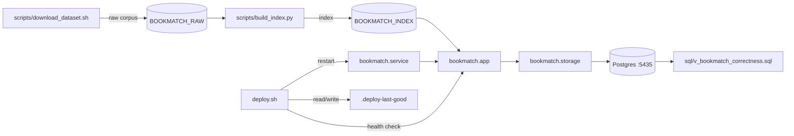

<!-- GENERATED by the doc pipeline — DO NOT EDIT. Hand edits are detected nightly and overwritten. To change this document, change the code or the harvest config (infrastructure/docs/pipeline). -->
[Scope](1_SCOPE_AND_PURPOSE.md) · **System** · [Flows](3_WORKFLOWS.md) · [Data](4_DATA_AND_INTEGRATIONS.md) · [Quality](5_QUALITY_AND_OPERATIONS.md) · [Internals](6_INTERNALS.md)

# bookmatch — System Architecture

## Components

### `scripts/download_dataset.sh`
- **Role:** Downloads the UCSD Goodreads corpus (Wan & McAuley 2018) via direct HTTP with resume support. Fetches four files: `goodreads_interactions.csv`, `book_id_map.csv`, `goodreads_books.json.gz`, and `goodreads_book_authors.json.gz`. Uses curl with resume (`-C -`), retries (`--retry 5`), and a 2-hour timeout per file. The destination defaults to `~/data/goodreads-ucsd/raw` but can be overridden by the first script argument.
- **Entry point:** `scripts/download_dataset.sh`

### `scripts/build_index.py`
- **Role:** Builds the neighbor-gap index from the raw UCSD Goodreads corpus. Produces `user_item.npz`, `book_lookup.sqlite`, and `meta.json`. Idempotent and rewrites the index directory on each run. The raw data directory is configurable via `BOOKMATCH_RAW` (default `~/data/goodreads-ucsd/raw`); the output index directory via `BOOKMATCH_INDEX` (default `~/data/goodreads-ucsd/index`).
- **Entry point:** `scripts/build_index.py`

### `bookmatch.storage`
- **Role:** Manages the `books.*` schema. `storage.ensure_schema_ready()` verifies only and raises if `books.*` is missing — it never creates the schema as a side effect. Bootstrap/upgrade is done explicitly via `python3 -m bookmatch.storage`, run as a role that holds CREATE on the `livingos` database.
- **Entry point:** `bookmatch/storage.py`

### `bookmatch.app`
- **Role:** The FastAPI application exposing `/api/health` and the primary analyze path. Depends on `storage.ensure_schema_ready()` at startup.
- **Entry point:** `bookmatch/app.py`

### `sql/v_bookmatch_correctness.sql`
- **Role:** Defines `books.v_bookmatch_correctness`, the ADR-0071 correctness surface. Per account, asserts the pipeline produced a grounded result: shelf ingested, taste axes complete, UCSD corpus matched, non-empty recs and profile.
- **Entry point:** `sql/v_bookmatch_correctness.sql`

### `deploy.sh`
- **Role:** Deploys bookmatch in-place by restarting the systemd unit with the merged code on the main branch. Refuses to deploy if the current branch is not `main`, the working tree is dirty, or HEAD does not match `origin/main`. Restarts the unit using `sudo -n`, requiring a valid sudo ticket. On success, records the deployed commit hash in `.deploy-last-good`; on failure, rolls back to the last known-good revision and exits non-zero.
- **Entry point:** `deploy.sh`

## Connections

- `scripts/download_dataset.sh` writes the raw corpus to `BOOKMATCH_RAW`, which `scripts/build_index.py` reads.
- `scripts/build_index.py` writes the index to `BOOKMATCH_INDEX`, which `bookmatch.app` reads for the analyze path.
- `bookmatch.app` calls `storage.ensure_schema_ready()` from `bookmatch.storage` at startup; this call verifies only and raises if `books.*` is missing.
- `bookmatch.storage` manages the `books.*` schema in Postgres (`:5435`), which `sql/v_bookmatch_correctness.sql` defines as a view.
- `deploy.sh` restarts the `bookmatch.service` systemd unit, which runs `bookmatch.app` on port `:8092`.
- `deploy.sh` checks `/api/health` for `ok` and `corpus_ready` flags, polling up to 20 seconds.
- `deploy.sh` records the deployed commit hash in `.deploy-last-good` on success; on failed deploy, it rolls back to the last known-good revision recorded in `.deploy-last-good`.

## Diagram

