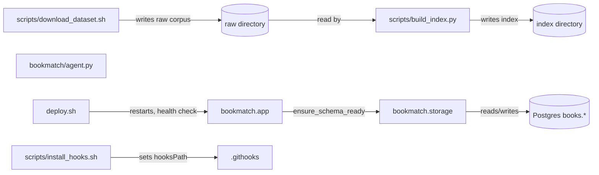

<!-- GENERATED by the doc pipeline — DO NOT EDIT. Hand edits are detected nightly and overwritten. To change this document, change the code or the harvest config (infrastructure/docs/pipeline). -->
[Scope](1_SCOPE_AND_PURPOSE.md) · **System** · [Flows](3_WORKFLOWS.md) · [Data](4_DATA_AND_INTEGRATIONS.md) · [Quality](5_QUALITY_AND_OPERATIONS.md) · [Internals](6_INTERNALS.md)

# bookmatch — system architecture

## Subsystem: Bookmatch

- **Role:** Serve the recommendation app, persist its account and shelf state, and build its local corpus index.
- **Entry point:** `bookmatch/app.py` for HTTP; `scripts/build_index.py` for index builds; `deploy.sh` for deployment.
- **Components:**
  - `bookmatch.app`: Serves the HTTP API and the dark-theme SPA. Calls `ensure_schema_ready` to verify the `books.*` schema exists before serving; it never creates the schema. Entry point: `bookmatch/app.py`.
  - `bookmatch.storage`: Owns all database access to the `books.*` schema in Postgres. Exposes `ensure_schema_ready`, which verifies the schema exists and raises if missing. Entry point: `bookmatch/storage.py`.
  - `bookmatch/agent.py`: UNKNOWN (fact not harvested). Entry point: `bookmatch/agent.py`.
  - `scripts/build_index.py`: Builds the neighbor-gap index from the raw UCSD Goodreads corpus. Reads `goodreads_interactions.csv`, `book_id_map.csv`, `goodreads_books.json.gz`, and `goodreads_book_authors.json.gz`; outputs `user_item.npz`, `book_lookup.sqlite`, and `meta.json`. Keeps interactions with `rating > 0` as the collaborative filtering signal. The source describes the rating domain as 1..5; the filter enforces no upper bound. Idempotent; rewrites the index directory each run. Entry point: `scripts/build_index.py`.
  - `scripts/download_dataset.sh`: Downloads the UCSD Goodreads corpus (Wan & McAuley 2018) via direct HTTP, resumable. Downloads four files: interactions, book_id_map, books, and book_authors. Uses curl with resume support, retries, and a 2-hour timeout. Entry point: `scripts/download_dataset.sh`.
  - `deploy.sh`: Deploys bookmatch in-place: restarts the systemd unit with the merged code, then proves health. Refuses to deploy unless the current branch is `main`, the working tree is clean and HEAD matches `origin/main`. Attempts rollback to the recorded last known-good revision if health checks fail; rollback may fail or have no target, and the deploy exits non-zero even after a successful rollback. Entry point: `deploy.sh`.
  - `scripts/install_hooks.sh`: Activates the tracked git hooks by setting `core.hooksPath` to `.githooks`. Must be run once per fresh clone to enable the ADR-0020 test gate. Entry point: `scripts/install_hooks.sh`.

## Connections

- `scripts/download_dataset.sh` writes the raw corpus to the raw directory (`BOOKMATCH_RAW`), which `scripts/build_index.py` reads.
- `scripts/build_index.py` reads the raw corpus and writes the index directory (`BOOKMATCH_INDEX`).
- `bookmatch.app` calls `ensure_schema_ready` to verify the `books.*` schema exists before serving.
- `bookmatch.storage` reads and writes the `books.*` schema in Postgres.
- `bookmatch/agent.py` is a component with no harvested connections.
- `deploy.sh` restarts the bookmatch systemd service and checks `/api/health` for both `ok` and `corpus_ready`.
- `deploy.sh` records the deployed revision in `.deploy-last-good` on success. On health failure it attempts the recorded rollback target; rollback may fail or lack a target, and the deploy exits nonzero.
- `scripts/install_hooks.sh` sets `core.hooksPath` to `.githooks`, enabling the pre-push test gate.

## Diagram

