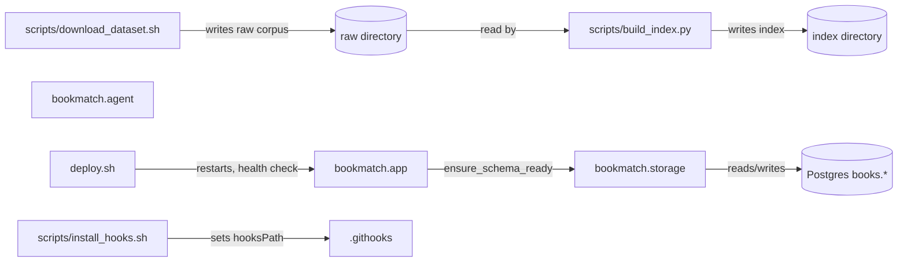

<!-- GENERATED by the doc pipeline — DO NOT EDIT. Hand edits are detected nightly and overwritten. To change this document, change the code or the harvest config (infrastructure/docs/pipeline). -->
[Scope](1_SCOPE_AND_PURPOSE.md) · **System** · [Flows](3_WORKFLOWS.md) · [Data](4_DATA_AND_INTEGRATIONS.md) · [Quality](5_QUALITY_AND_OPERATIONS.md) · [Internals](6_INTERNALS.md)

# bookmatch — system architecture

## Components

### `bookmatch.app`
- **Role:** Serves the HTTP API and the dark-theme SPA. Calls `storage.ensure_schema_ready` to verify the `books.*` schema exists before serving; it never creates the schema.
- **Entry point:** `bookmatch/app.py`.

### `bookmatch.storage`
- **Role:** Owns all database access to the `books.*` schema in Postgres. Exposes `storage.ensure_schema_ready`, which verifies the schema exists and raises if missing.
- **Entry point:** `bookmatch/storage.py`.

### `bookmatch.agent`
- **Role:** UNKNOWN (fact not harvested).
- **Entry point:** `bookmatch/agent.py`.

### `scripts/build_index.py`
- **Role:** Builds the neighbor-gap index from the raw UCSD Goodreads corpus. Reads `goodreads_interactions.csv`, `book_id_map.csv`, `goodreads_books.json.gz`, and `goodreads_book_authors.json.gz`; outputs `user_item.npz`, `book_lookup.sqlite`, and `meta.json`. Keeps only rated interactions (rating in 1..5) as the collaborative filtering signal. Idempotent; rewrites the index directory each run.
- **Entry point:** `scripts/build_index.py`.

### `scripts/download_dataset.sh`
- **Role:** Downloads the UCSD Goodreads corpus (Wan & McAuley 2018) via direct HTTP, resumable. Downloads four files: interactions, book_id_map, books, and book_authors. Uses curl with resume support, retries, and a 2-hour timeout.
- **Entry point:** `scripts/download_dataset.sh`.

### `deploy.sh`
- **Role:** Deploys bookmatch in-place: restarts the systemd unit with the merged code, then proves health. Refuses to deploy unless the current branch is `main`, the working tree is dirty, or HEAD does not match `origin/main`. Rolls back to the last known-good revision if health checks fail; exits non-zero even after a successful rollback.
- **Entry point:** `deploy.sh`.

### `scripts/install_hooks.sh`
- **Role:** Activates the tracked git hooks by setting `core.hooksPath` to `.githooks`. Must be run once per fresh clone to enable the ADR-0020 test gate.
- **Entry point:** `scripts/install_hooks.sh`.

## Connections

- `scripts/download_dataset.sh` writes the raw corpus to the raw directory (`BOOKMATCH_RAW`), which `scripts/build_index.py` reads.
- `scripts/build_index.py` reads the raw corpus and writes the index directory (`BOOKMATCH_INDEX`).
- `bookmatch.app` calls `storage.ensure_schema_ready` to verify the `books.*` schema exists before serving.
- `bookmatch.storage` reads and writes the `books.*` schema in Postgres.
- `bookmatch.agent` is a component with no harvested connections.
- `deploy.sh` restarts the bookmatch systemd service and checks `/api/health` for both `ok` and `corpus_ready`.
- `deploy.sh` records the deployed revision in `.deploy-last-good` on success and rolls back to the last known-good revision on failure.
- `scripts/install_hooks.sh` sets `core.hooksPath` to `.githooks`, enabling the pre-push test gate.

## Diagram

