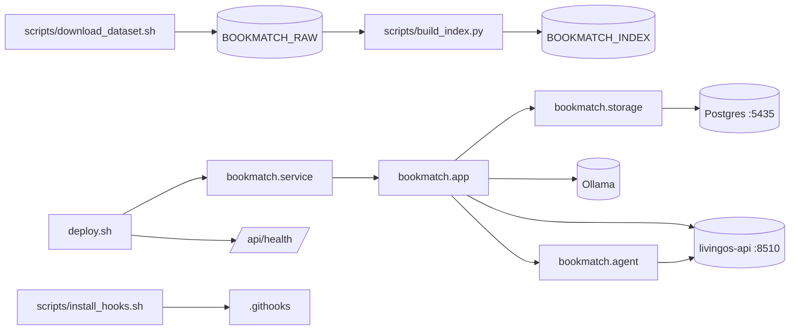

<!-- GENERATED by the doc pipeline — DO NOT EDIT. Hand edits are detected nightly and overwritten. To change this document, change the code or the harvest config (infrastructure/docs/pipeline). -->
[Scope](1_SCOPE_AND_PURPOSE.md) · **System** · [Flows](3_WORKFLOWS.md) · [Data](4_DATA_AND_INTEGRATIONS.md) · [Quality](5_QUALITY_AND_OPERATIONS.md) · [Internals](6_INTERNALS.md)

# bookmatch — system architecture

## Components

### `scripts/download_dataset.sh`
- **Role:** Downloads the UCSD Goodreads corpus (Wan & McAuley 2018) via direct HTTP with resume support. It fetches four files: interactions, book_id_map, books, and authors. It does not build or transform the data.
- **Entry point:** `scripts/download_dataset.sh`

### `scripts/build_index.py`
- **Role:** Builds the neighbor-gap index from the raw UCSD Goodreads corpus. It reads rated interactions (rating in 1..5) as the collaborative filtering signal, outputs `user_item.npz`, `book_lookup.sqlite`, and `meta.json` to the index directory, and is idempotent — it rewrites the index directory each run. It does not serve recommendations.
- **Entry point:** `scripts/build_index.py`

### `bookmatch.storage`
- **Role:** Manages the `books.*` schema. `storage.ensure_schema_ready()` verifies the schema exists and raises if missing; it never creates the schema as a side effect of app start or test run. Schema creation is migration-time-only, via `python3 -m bookmatch.storage`.
- **Entry point:** `bookmatch/storage.py`

### `bookmatch.app`
- **Role:** The application entry point, exposing the HTTP API. It calls `storage.ensure_schema_ready()` at startup. It does not create the schema.
- **Entry point:** `bookmatch/app.py`

### `bookmatch.agent`
- **Role:** The agent component that provides chat-based interaction. It is reachable from the app entry point.
- **Entry point:** `bookmatch/agent.py`

### `deploy.sh`
- **Role:** Deploys bookmatch in-place by restarting the systemd unit with the merged code. It refuses to deploy unless on the `main` branch with a clean tree, verifies HEAD matches `origin/main`, restarts `bookmatch.service` using `sudo -n`, and considers a deploy healthy only if `/api/health` reports `ok` AND `corpus_ready`. It rolls back to the last known-good revision if health checks fail within 20 seconds.
- **Entry point:** `deploy.sh`

### `scripts/install_hooks.sh`
- **Role:** Activates the tracked git hooks by setting `core.hooksPath` to `.githooks`. It must be run once per fresh clone to enable the ADR-0020 test gate.
- **Entry point:** `scripts/install_hooks.sh`

## Connections

- `scripts/download_dataset.sh` writes raw corpus files to the raw data directory (`BOOKMATCH_RAW`, default `~/data/goodreads-ucsd/raw`).
- `scripts/build_index.py` reads raw data from `BOOKMATCH_RAW` and writes the index to `BOOKMATCH_INDEX` (default `~/data/goodreads-ucsd/index`).
- `bookmatch.storage` reads and writes the `books.*` schema in Postgres (`:5435`).
- `bookmatch.app` calls `storage.ensure_schema_ready()` from `bookmatch.storage` at startup.
- `bookmatch.app` serves the HTTP API on port `:8092` and exposes `/api/health`.
- `bookmatch.app` depends on the livingos-api gateway (`:8510`) and Ollama (`nomic-embed-text`).
- `bookmatch.agent` is reachable from `bookmatch.app` and depends on the livingos-api gateway (`:8510`).
- `deploy.sh` restarts the `bookmatch.service` systemd unit, which runs `bookmatch.app`.
- `deploy.sh` checks `/api/health` on `bookmatch.app` to verify health.
- `scripts/install_hooks.sh` sets `core.hooksPath` to `.githooks` in the repository root.

## Diagram

