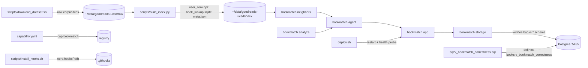

<!-- GENERATED by the doc pipeline — DO NOT EDIT. Hand edits are detected nightly and overwritten. To change this document, change the code or the harvest config (infrastructure/docs/pipeline). -->
[Scope](1_SCOPE_AND_PURPOSE.md) · **System** · [Flows](3_WORKFLOWS.md) · [Data](4_DATA_AND_INTEGRATIONS.md) · [Quality](5_QUALITY_AND_OPERATIONS.md) · [Internals](6_INTERNALS.md)

# bookmatch — System architecture

## Components

### `scripts/download_dataset.sh`
- **Role:** Downloads the UCSD Goodreads corpus (Wan & McAuley 2018) via direct HTTP with resume support, retries, and a 2-hour timeout per file. Downloads four files: interactions, book map, books, and authors.
- **Entry point:** `scripts/download_dataset.sh`

### `scripts/build_index.py`
- **Role:** Builds the neighbor-gap index from the raw UCSD Goodreads corpus. Reads `goodreads_interactions.csv`, `book_id_map.csv`, `goodreads_books.json.gz`, and `goodreads_book_authors.json.gz`. Outputs `user_item.npz`, `book_lookup.sqlite`, and `meta.json`. Only keeps rated interactions (rating in 1..5) as the collaborative filtering signal. Idempotent, rewrites the index directory each run, processes interactions in chunks of 20 million rows.
- **Entry point:** `scripts/build_index.py`

### `bookmatch.storage`
- **Role:** Manages the `books.*` schema. `ensure_schema_ready()` verifies schema presence and raises if missing — never creates schema as a side effect of app start or test run. Schema bootstrap/upgrade happens via `python3 -m bookmatch.storage`.
- **Entry point:** `bookmatch/storage.py`

### `bookmatch.app`
- **Role:** The FastAPI application serving the API on port `:8092`. Calls `storage.ensure_schema_ready()` at startup. Exposes `/api/health` for health checks.
- **Entry point:** `bookmatch/app.py`

### `bookmatch.agent`
- **Role:** The chat agent component that converses with users about book preferences and recommendations.
- **Entry point:** `bookmatch/agent.py`

### `sql/v_bookmatch_correctness.sql`
- **Role:** Defines `books.v_bookmatch_correctness`, the ADR-0071 correctness surface. Per account, asserts the pipeline produced a grounded result: shelf ingested, taste axes complete, UCSD corpus matched, non-empty recs and profile.
- **Entry point:** `sql/v_bookmatch_correctness.sql`

### `capability.yaml`
- **Role:** Capability manifest declaring `cap.bookmatch` (ADR-0095), crawled into the registry.
- **Entry point:** `capability.yaml`

### `deploy.sh`
- **Role:** In-place deployment script. Refuses to deploy with a dirty working tree. Restarts the systemd unit, proves health via `/api/health`, rolls back to last-good on failure. Fail-loud: no sudo ticket, failed restart, or dead health check abort non-zero.
- **Entry point:** `deploy.sh`

### `scripts/install_hooks.sh`
- **Role:** Activates tracked git hooks by setting `core.hooksPath` to `.githooks`. Must be run once per fresh clone to activate the ADR-0020 test gate.
- **Entry point:** `scripts/install_hooks.sh`

## Connections

- `scripts/download_dataset.sh` writes raw corpus files to `~/data/goodreads-ucsd/raw` (via `BOOKMATCH_RAW`), which `scripts/build_index.py` reads.
- `scripts/build_index.py` reads `goodreads_interactions.csv`, `book_id_map.csv`, `goodreads_books.json.gz`, and `goodreads_book_authors.json.gz` from the raw corpus directory.
- `scripts/build_index.py` writes `user_item.npz`, `book_lookup.sqlite`, and `meta.json` to the index directory (via `BOOKMATCH_INDEX`).
- `bookmatch.app` calls `storage.ensure_schema_ready()` at startup; `bookmatch.storage` verifies the `books.*` schema in Postgres.
- `bookmatch.app` serves the API on `:8092`; `deploy.sh` restarts the unit and probes `/api/health`.
- `bookmatch.agent` uses `bookmatch.analyze` and `bookmatch.neighbors` for taste profiling and recommendations. UNKNOWN (fact not harvested).
- `sql/v_bookmatch_correctness.sql` defines `books.v_bookmatch_correctness`, which validates the pipeline output produced by `bookmatch.analyze` and `bookmatch.neighbors`. UNKNOWN (fact not harvested).
- `capability.yaml` declares `cap.bookmatch`, crawled into the registry.
- `scripts/install_hooks.sh` sets `core.hooksPath` to `.githooks`, activating the pre-push test gate.

## Diagram

