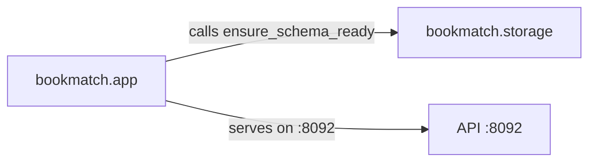

<!-- GENERATED by the doc pipeline — DO NOT EDIT. Hand edits are detected nightly and overwritten. To change this document, change the code or the harvest config (infrastructure/docs/pipeline). -->
[Scope](1_SCOPE_AND_PURPOSE.md) · **System** · [Flows](3_WORKFLOWS.md) · [Data](4_DATA_AND_INTEGRATIONS.md) · [Quality](5_QUALITY_AND_OPERATIONS.md) · [Internals](6_INTERNALS.md)

# bookmatch — index build, in-place deploy, and health-gated service lifecycle

## Components

### `bookmatch.app`
**Role:** the application entry point. Calls `storage.ensure_schema_ready` at startup to verify the `books.*` schema exists. Serves the API on port `:8092`.
**Entry point:** `bookmatch/app.py`

### `bookmatch.storage`
**Role:** storage layer. Provides `ensure_schema_ready`, which verifies the `books.*` schema is present and raises if missing. Schema is never created as a side effect of app start or test run.
**Entry point:** `bookmatch/storage.py`

## Connections

- `bookmatch.app` calls `storage.ensure_schema_ready` at startup.
- `bookmatch.app` serves the API on port `:8092`.

## Diagram

