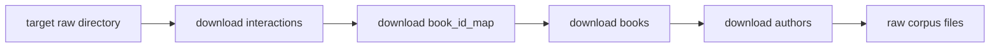
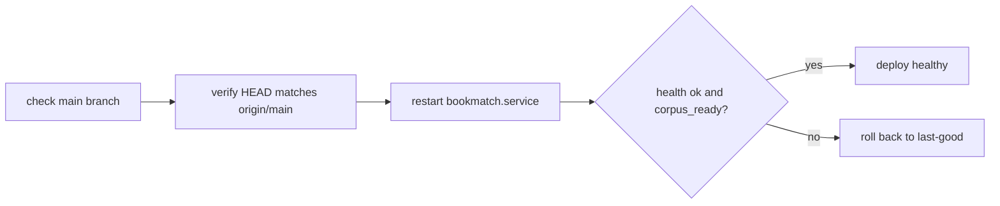

<!-- GENERATED by the doc pipeline — DO NOT EDIT. Hand edits are detected nightly and overwritten. To change this document, change the code or the harvest config (infrastructure/docs/pipeline). -->
[Scope](1_SCOPE_AND_PURPOSE.md) · [System](2_SYSTEM_ARCHITECTURE.md) · **Flows** · [Data](4_DATA_AND_INTEGRATIONS.md) · [Quality](5_QUALITY_AND_OPERATIONS.md) · [Internals](6_INTERNALS.md)

# bookmatch — build, deploy, and health flows

## Workflow: Index build (scripts/build_index.py)

**Trigger:** manual run of `python3 scripts/build_index.py` after the raw corpus is present.

**Steps:**
1. Read raw data from `BOOKMATCH_RAW` env var, defaulting to `~/data/goodreads-ucsd/raw` (`scripts/build_index.py`).
2. Process `interactions.csv` in chunks of 20 million rows (`scripts/build_index.py`).
3. Call `build_matrix()` to read `interactions.csv`, filter `rating > 0`, and build a scipy CSR matrix with int32 user/book IDs, int8 ratings, and float32 values (`scripts/build_index.py`).
4. Sum duplicate entries in the CSR matrix (`scripts/build_index.py`).
5. Call `build_lookup()` to load author ID to name mappings from `goodreads_book_authors.json.gz` (`scripts/build_index.py`).
6. Load the remapped book_id to real book_id mapping from `book_id_map.csv` (`scripts/build_index.py`).
7. Stream `books.json.gz` and insert batches of 50,000 books into SQLite, skipping books without a remapped ID or title (`scripts/build_index.py`).
8. Use the first author's name for each book (`scripts/build_index.py`).
9. Create an index on the lookup table's `normkey` column (`scripts/build_index.py`).
10. Write `user_item.npz`, `book_lookup.sqlite`, and `meta.json` to the index directory (`scripts/build_index.py`).

**Output:** `user_item.npz`, `book_lookup.sqlite`, and `meta.json` in the `BOOKMATCH_INDEX` directory, defaulting to `~/data/goodreads-ucsd/index`.

**Failure behavior:** The build is idempotent and rewrites the index directory each run; a failed run leaves the previous index intact. UNKNOWN (fact not harvested) for retry or error reporting specifics.

**Diagram:**

## Workflow: Dataset download (scripts/download_dataset.sh)

**Trigger:** manual run of `scripts/download_dataset.sh` to fetch the UCSD Goodreads corpus.

**Steps:**
1. Target `~/data/goodreads-ucsd/raw` by default, which is gitignored (`scripts/download_dataset.sh`).
2. Download four files: interactions, book_id_map, books, and authors (`scripts/download_dataset.sh`).
3. Use curl with resume (`-C -`), retries, and a 2-hour timeout per file (`scripts/download_dataset.sh`).

**Output:** Four raw corpus files in `~/data/goodreads-ucsd/raw`.

**Failure behavior:** curl retries with resume support; UNKNOWN (fact not harvested) for retry count or abort behavior.

**Diagram:**

## Workflow: Git hook activation (scripts/install_hooks.sh)

**Trigger:** manual run of `scripts/install_hooks.sh` once per fresh clone.

**Steps:**
1. Set `core.hooksPath` to `.githooks` in the repository root (`scripts/install_hooks.sh`).

**Output:** Repository `core.hooksPath` points at `.githooks`, enabling the ADR-0020 test gate.

**Failure behavior:** The hook must be run once per fresh clone, or pushes silently bypass the ADR-0020 test gate.

**Diagram:**

## Workflow: Deploy (deploy.sh)

**Trigger:** manual run of `./deploy.sh` on the main branch.

**Steps:**
1. Refuse to deploy unless on the main branch with a clean tree (`deploy.sh`).
2. Verify HEAD matches `origin/main` before deploying (`deploy.sh`).
3. Restart `bookmatch.service` using `sudo -n`, requiring a valid sudo ticket (`deploy.sh`).
4. Probe `/api/health` and require it to report `ok` AND `corpus_ready` (`deploy.sh`).
5. Roll back to the last known-good revision if health checks fail within 20 seconds (`deploy.sh`).

**Output:** `bookmatch.service` running the merged code, with `/api/health` reporting `ok` and `corpus_ready`.

**Failure behavior:** Fail-loud everywhere: no sudo ticket, failed restart, or a dead `/api/health` all abort non-zero; rolls back to the last known-good revision if health checks fail within 20 seconds.

**Diagram:**

## Workflow: Health probe (/api/health)

**Trigger:** external request to `/api/health` on port `:8092`.

**Steps:**
1. Receive request at `/api/health` (`deploy.sh`).
2. Compute response from the live systemd unit and corpus readiness (`deploy.sh`).

**Output:** HTTP response reporting `ok` and `corpus_ready` status.

**Failure behavior:** UNKNOWN (fact not harvested).

**Diagram:**
