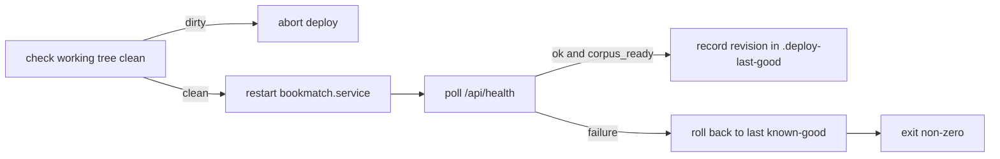

<!-- GENERATED by the doc pipeline — DO NOT EDIT. Hand edits are detected nightly and overwritten. To change this document, change the code or the harvest config (infrastructure/docs/pipeline). -->
[Scope](1_SCOPE_AND_PURPOSE.md) · [System](2_SYSTEM_ARCHITECTURE.md) · **Flows** · [Data](4_DATA_AND_INTEGRATIONS.md) · [Quality](5_QUALITY_AND_OPERATIONS.md) · [Internals](6_INTERNALS.md)

# bookmatch — index build, deploy, and hook activation flows

## Workflow: Index build (scripts/build_index.py)

**Trigger:** manual one-time run via `python3 scripts/build_index.py` after `scripts/download_dataset.sh` has populated `BOOKMATCH_RAW` (default `~/data/goodreads-ucsd/raw`).

**Steps:**
1. Reads input data from `BOOKMATCH_RAW` (default `~/data/goodreads-ucsd/raw`).
2. `build_matrix` reads the interactions CSV in chunks of 20 million rows, filtering for ratings greater than zero (`scripts/build_index.py:36`).
3. `build_matrix` constructs a scipy CSR matrix of shape `(n_users, n_items)` from the filtered ratings (`scripts/build_index.py:62`).
4. `build_matrix` calls `sum_duplicates()` on the CSR matrix to combine duplicate entries (`scripts/build_index.py:63`).
5. `build_lookup` loads author IDs and names from a gzipped JSON file (`scripts/build_index.py:70`).
6. `build_lookup` loads the book ID mapping from `book_id_map.csv`, mapping real book IDs to remapped IDs (`scripts/build_index.py:77`).
7. `build_lookup` creates a SQLite database at `OUT/book_lookup.sqlite` with tables `books` and `lookup` (`scripts/build_index.py:83`).
8. `build_lookup` streams books from `goodreads_books.json.gz`, skipping books without a remapped ID or title (`scripts/build_index.py:98`).
9. `build_lookup` uses the `normkey` function from `bookmatch.match` to generate lookup keys from title and author (`scripts/build_index.py:109`).
10. `build_lookup` inserts books into the SQLite database in batches of 50,000 (`scripts/build_index.py:111`).
11. `build_lookup` creates an index on the lookup table's `normkey` column (`scripts/build_index.py:120`).
12. Writes output to `BOOKMATCH_INDEX` (default `~/data/goodreads-ucsd/index`), rewriting the index directory on each run (`scripts/build_index.py:16`, `scripts/build_index.py:35`).

**Output:** A user-item rating matrix and a SQLite database at `BOOKMATCH_INDEX` (default `~/data/goodreads-ucsd/index`) containing `book_lookup.sqlite` with `books` and `lookup` tables.

**Failure behavior:** The build is idempotent and rewrites the index directory on each run; a failed run leaves the previous index intact. UNKNOWN (fact not harvested).

## Workflow: Dataset download (scripts/download_dataset.sh)

**Trigger:** manual one-time run via `scripts/download_dataset.sh` to fetch the UCSD Goodreads corpus.

**Steps:**
1. Downloads four files via HTTP: interactions CSV, book ID map, books JSON, and authors JSON (`scripts/download_dataset.sh:8`).
2. Uses `curl` with retry and timeout options for each file download (`scripts/download_dataset.sh:16`).
3. Writes files to `~/data/goodreads-ucsd/raw` (gitignored, ~6.5 GB).

**Output:** Four corpus files in `~/data/goodreads-ucsd/raw`.

**Failure behavior:** Downloads are resumable via `curl` resume support. UNKNOWN (fact not harvested).

## Workflow: Git hook activation (scripts/install_hooks.sh)

**Trigger:** manual one-time run per fresh clone via `scripts/install_hooks.sh`.

**Steps:**
1. Sets `core.hooksPath` to `.githooks` (`scripts/install_hooks.sh:7`).
2. Activates the ADR-0020 test gate (`scripts/install_hooks.sh:4`).

**Output:** The repository's `core.hooksPath` points at `.githooks`, enabling the pre-push test gate.

**Failure behavior:** UNKNOWN (fact not harvested).

## Workflow: In-place deploy (deploy.sh)

**Trigger:** manual run via `./deploy.sh` on aurora to deploy the merged code.

**Steps:**
1. Refuses to deploy if the working tree is dirty (`deploy.sh:11`).
2. Restarts the `bookmatch.service` systemd unit using `sudo -n systemctl restart` (`deploy.sh:35`).
3. Polls `/api/health` for `ok` and `corpus_ready` status (`deploy.sh:25`).
4. On success, records the deployed revision in `.deploy-last-good` (`deploy.sh:38`).
5. On health check failure, rolls back to the last known-good revision (`deploy.sh:49`).
6. Exits with a non-zero status even after a successful rollback, marking the deploy as failed (`deploy.sh:59`).

**Output:** The `bookmatch.service` unit runs the merged code, and `.deploy-last-good` records the deployed revision on success.

**Failure behavior:** A dirty working tree aborts the deploy; a failed restart or dead `/api/health` aborts non-zero; a failed health check rolls back to the last known-good revision and still exits non-zero.

