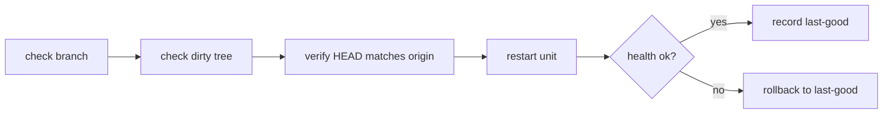

<!-- GENERATED by the doc pipeline — DO NOT EDIT. Hand edits are detected nightly and overwritten. To change this document, change the code or the harvest config (infrastructure/docs/pipeline). -->
[Scope](1_SCOPE_AND_PURPOSE.md) · [System](2_SYSTEM_ARCHITECTURE.md) · **Flows** · [Data](4_DATA_AND_INTEGRATIONS.md) · [Quality](5_QUALITY_AND_OPERATIONS.md) · [Internals](6_INTERNALS.md)

# bookmatch — index build, dataset download, and in-place deploy flows

## Workflow: Index build (`scripts/build_index.py`)

**Trigger:** manual invocation of `scripts/build_index.py`; the script is idempotent and rewrites the index directory on each run.

**Steps:**
1. Read the raw data directory from `BOOKMATCH_RAW`, defaulting to `~/data/goodreads-ucsd/raw` (`scripts/build_index.py`).
2. Read the output index directory from `BOOKMATCH_INDEX`, defaulting to `~/data/goodreads-ucsd/index` (`scripts/build_index.py`).
3. Call `build_matrix`, which reads `goodreads_interactions.csv` in chunks of 20 million rows, keeping only rated interactions (`rating > 0`) (`scripts/build_index.py`).
4. Construct a scipy CSR matrix of shape `(n_users x n_items)` with float32 ratings, summing duplicate entries (`scripts/build_index.py`).
5. Call `build_lookup`, which loads author names from `goodreads_book_authors.json.gz` into a dictionary keyed by `author_id` (`scripts/build_index.py`).
6. Load `book_id_map.csv` to map real book IDs to remapped IDs (`scripts/build_index.py`).
7. Create a SQLite database with a `books` table (`book_id`, `title`, `author`) and a `lookup` table (`normkey`, `book_id`) (`scripts/build_index.py`).
8. Stream `goodreads_books.json.gz`, inserting books in batches of 50,000 with `INSERT OR IGNORE` for the `books` table (`scripts/build_index.py`).
9. Create an index on the `lookup` table's `normkey` column for fast lookups (`scripts/build_index.py`).
10. Write the output files `user_item.npz`, `book_lookup.sqlite`, and `meta.json` to the index directory (`scripts/build_index.py`).

**Output:** `user_item.npz`, `book_lookup.sqlite`, and `meta.json` in the `BOOKMATCH_INDEX` directory (default `~/data/goodreads-ucsd/index`).

**Failure behavior:** the script is idempotent and rewrites the index directory on each run, so a failed run can be re-run; no explicit retry or park behavior is documented.

**Diagram:**

## Workflow: Dataset download (`scripts/download_dataset.sh`)

**Trigger:** manual invocation of `scripts/download_dataset.sh`; the download destination defaults to `~/data/goodreads-ucsd/raw` but can be overridden by the first script argument.

**Steps:**
1. Fetch `goodreads_interactions.csv`, `book_id_map.csv`, `goodreads_books.json.gz`, and `goodreads_book_authors.json.gz` via direct HTTP (`scripts/download_dataset.sh`).
2. Use `curl` with resume (`-C -`), retries (`--retry 5`), and a 2-hour timeout per file (`scripts/download_dataset.sh`).
3. Write the downloaded files to the destination directory (default `~/data/goodreads-ucsd/raw`, gitignored, ~6.5 GB) (`scripts/download_dataset.sh`).

**Output:** the four corpus files in the destination directory (default `~/data/goodreads-ucsd/raw`).

**Failure behavior:** `curl` retries up to 5 times per file and supports resume (`-C -`), so an interrupted download can be resumed; no explicit abort or park behavior is documented.

**Diagram:**

## Workflow: Git hook activation (`scripts/install_hooks.sh`)

**Trigger:** manual invocation of `scripts/install_hooks.sh`; must be run once per fresh clone.

**Steps:**
1. Set `core.hooksPath` to `.githooks` (`scripts/install_hooks.sh`).
2. Activate the tracked git hooks, ensuring pushes do not bypass the ADR-0020 test gate (`scripts/install_hooks.sh`).

**Output:** `core.hooksPath` points at `.githooks`, so the pre-push test gate runs on subsequent pushes.

**Failure behavior:** UNKNOWN (fact not harvested); a committed `.githooks/` is inert until `hooksPath` points at it, so a skipped run silently bypasses the test gate.

**Diagram:**

## Workflow: In-place deploy (`deploy.sh`)

**Trigger:** manual invocation of `deploy.sh` on the main branch.

**Steps:**
1. Refuse to deploy if the current branch is not `main` (`deploy.sh`).
2. Refuse to deploy if the working tree is dirty (`deploy.sh`).
3. Verify `HEAD` matches `origin/main` before deploying (`deploy.sh`).
4. Restart the `bookmatch.service` systemd unit with the merged code, using `sudo -n` (requires a valid sudo ticket) (`deploy.sh`).
5. Call `healthy()`, which checks `/api/health` for both `ok` and `corpus_ready` flags, polling up to 20 seconds (`deploy.sh`).
6. On success, record the deployed commit hash in `.deploy-last-good` (`deploy.sh`).

**Output:** the `bookmatch.service` unit runs the merged code, and `.deploy-last-good` records the deployed commit hash.

**Failure behavior:** on failed deploy, roll back to the last known-good revision recorded in `.deploy-last-good`; log a warning if the rollback restart also fails; log an error if no last-good revision is recorded, making rollback impossible; any failure aborts non-zero (`deploy.sh`).

**Diagram:**
