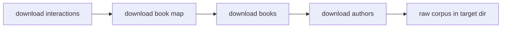
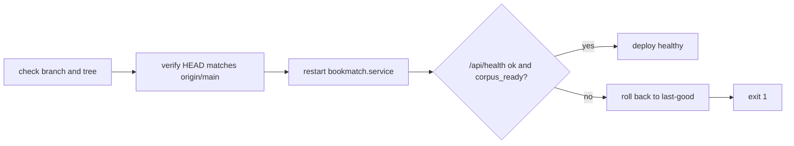

<!-- GENERATED by the doc pipeline — DO NOT EDIT. Hand edits are detected nightly and overwritten. To change this document, change the code or the harvest config (infrastructure/docs/pipeline). -->
[Scope](1_SCOPE_AND_PURPOSE.md) · [System](2_SYSTEM_ARCHITECTURE.md) · **Flows** · [Data](4_DATA_AND_INTEGRATIONS.md) · [Quality](5_QUALITY_AND_OPERATIONS.md) · [Internals](6_INTERNALS.md)

# bookmatch — index build, deploy, and hook activation flows

## Workflow: Index build (`scripts/build_index.py`)

**Trigger:** manual run of `python3 scripts/build_index.py`; one-time, multi-GB operation.

**Steps:**
1. Reads raw data from `BOOKMATCH_RAW`, defaulting to `~/data/goodreads-ucsd/raw` (`scripts/build_index.py`).
2. Writes output to `BOOKMATCH_INDEX`, defaulting to `~/data/goodreads-ucsd/index` (`scripts/build_index.py`).
3. `build_matrix()` reads `interactions.csv` in chunks of 20 million rows, filtering `rating > 0` (`scripts/build_index.py`).
4. `build_matrix()` constructs a scipy CSR matrix of shape `(n_users, n_items)` from rated interactions (`scripts/build_index.py`).
5. `build_matrix()` calls `sum_duplicates()` to merge duplicate user-item entries (`scripts/build_index.py`).
6. `build_lookup()` loads author id to name mappings from `goodreads_book_authors.json.gz` (`scripts/build_index.py`).
7. `build_lookup()` loads the remapped `book_id` to real `book_id` mapping from `book_id_map.csv` (`scripts/build_index.py`).
8. `build_lookup()` creates a SQLite database with `books` and `lookup` tables, disabling journaling for speed (`scripts/build_index.py`).
9. `build_lookup()` streams `goodreads_books.json.gz`, mapping real book IDs to remapped IDs (`scripts/build_index.py`).
10. `build_lookup()` skips books without a remapped ID or title (`scripts/build_index.py`).
11. `build_lookup()` extracts the first author's name for each book (`scripts/build_index.py`).
12. `build_lookup()` inserts `books` and `lookup` entries in batches of 50,000 (`scripts/build_index.py`).
13. `build_lookup()` creates an index on the `lookup` table's `normkey` column (`scripts/build_index.py`).

**Output:** `user_item.npz`, `book_lookup.sqlite`, and `meta.json` in the index directory (`BOOKMATCH_INDEX`).

**Failure behavior:** the script is idempotent and rewrites the index directory each run, so a failed run can be re-run; no explicit retry or park behavior is documented.

**Diagram:**

## Workflow: Dataset download (`scripts/download_dataset.sh`)

**Trigger:** manual run of `scripts/download_dataset.sh`; one-time download of the UCSD Goodreads corpus.

**Steps:**
1. Downloads four files: interactions, book map, books, and authors (`scripts/download_dataset.sh`).
2. Uses curl with resume (`-C -`), retries, and a 2-hour timeout per file (`scripts/download_dataset.sh`).

**Output:** the raw corpus in `~/data/goodreads-ucsd/raw` (gitignored, ~6.5 GB).

**Failure behavior:** UNKNOWN (fact not harvested).

**Diagram:**

## Workflow: Hook activation (`scripts/install_hooks.sh`)

**Trigger:** manual run of `scripts/install_hooks.sh` once per fresh clone.

**Steps:**
1. Sets `core.hooksPath` to `.githooks` in the repository's git config (`scripts/install_hooks.sh`).

**Output:** the tracked git hooks are active; the ADR-0020 test gate runs on push.

**Failure behavior:** UNKNOWN (fact not harvested); a committed `.githooks/` is inert until `hooksPath` points at it, so a skipped run silently bypasses the test gate.

**Diagram:**

## Workflow: Deploy (`deploy.sh`)

**Trigger:** manual run of `./deploy.sh` on aurora.

**Steps:**
1. Refuses to deploy unless on the `main` branch with a clean tree (`deploy.sh`).
2. Verifies `HEAD` matches `origin/main` before deploying (`deploy.sh`).
3. Restarts `bookmatch.service` using `sudo -n`, requiring a valid sudo ticket (`deploy.sh`).
4. Proves health by checking `/api/health` reports `ok` AND `corpus_ready` (`deploy.sh`).
5. Rolls back to the last known-good revision if health checks fail, but still exits 1 (`deploy.sh`).

**Output:** the systemd unit runs the merged code in place; a healthy `/api/health` response.

**Failure behavior:** fail-loud everywhere — no sudo ticket, failed restart, or a dead `/api/health` all abort non-zero; a failed health check rolls back to the last known-good revision and still exits 1.

**Diagram:**
