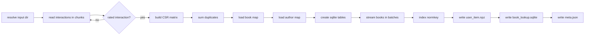
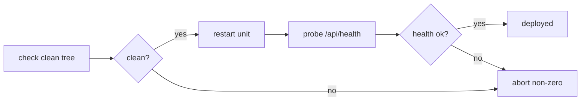

<!-- GENERATED by the doc pipeline — DO NOT EDIT. Hand edits are detected nightly and overwritten. To change this document, change the code or the harvest config (infrastructure/docs/pipeline). -->
[Scope](1_SCOPE_AND_PURPOSE.md) · [System](2_SYSTEM_ARCHITECTURE.md) · **Flows** · [Data](4_DATA_AND_INTEGRATIONS.md) · [Quality](5_QUALITY_AND_OPERATIONS.md) · [Internals](6_INTERNALS.md)

# bookmatch — index build, deploy, and health flows

## Workflow: Index build (scripts/build_index.py)

**Trigger:** manual run — `python3 scripts/build_index.py`.

**Steps:**
1. Resolve input directory from `BOOKMATCH_RAW` or default `~/data/goodreads-ucsd/raw` (`scripts/build_index.py:34`).
2. Resolve output directory from `BOOKMATCH_INDEX` or default `~/data/goodreads-ucsd/index` (`scripts/build_index.py:35`).
3. Read `goodreads_interactions.csv` in chunks of 20 million rows, keeping only rated interactions (`rating` in 1..5) (`scripts/build_index.py:36`, `scripts/build_index.py:15`).
4. Build a scipy CSR matrix of shape `(n_users, n_items)` from the rated interactions (`scripts/build_index.py:62`).
5. Sum duplicate entries in the sparse matrix (`scripts/build_index.py:63`).
6. Load `book_id_map.csv` to map remapped book IDs to real Goodreads book IDs (`scripts/build_index.py:77`).
7. Load `goodreads_book_authors.json.gz` to map `author_id` to name (`scripts/build_index.py:70`).
8. Create `book_lookup.sqlite` with `PRAGMA journal_mode=OFF` and `synchronous=OFF` (`scripts/build_index.py:88`).
9. Create `books` table with `book_id`, `title`, and `author` columns (`scripts/build_index.py:89`).
10. Create `lookup` table with `normkey` and `book_id` columns (`scripts/build_index.py:90`).
11. Stream `goodreads_books.json.gz` and insert into sqlite in batches of 50,000 (`scripts/build_index.py:111`).
12. Create an index on the `lookup` table's `normkey` column (`scripts/build_index.py:120`).
13. Write `user_item.npz` as a scipy CSR matrix of explicit ratings (`scripts/build_index.py:11`).
14. Write `book_lookup.sqlite` with books and lookup tables (`scripts/build_index.py:12`).
15. Write `meta.json` with `n_users`, `n_items`, `n_interactions`, and `built_at` (`scripts/build_index.py:13`).

**Output:** `user_item.npz`, `book_lookup.sqlite`, and `meta.json` in the index directory (`BOOKMATCH_INDEX` or `~/data/goodreads-ucsd/index`).

**Failure behavior:** The build is idempotent and rewrites the index directory each run; a failed run leaves the previous index intact.

**Diagram:**

## Workflow: Dataset download (scripts/download_dataset.sh)

**Trigger:** manual run — `scripts/download_dataset.sh`.

**Steps:**
1. Resolve destination from `BOOKMATCH_RAW` or default `~/data/goodreads-ucsd/raw` (`scripts/download_dataset.sh:6`).
2. Download four files from `mcauleylab.ucsd.edu`: interactions, book map, books, and authors (`scripts/download_dataset.sh:8`).
3. Use curl with resume support, retries, and a 2-hour timeout per file (`scripts/download_dataset.sh:16`).

**Output:** Four corpus files in the destination directory (`BOOKMATCH_RAW` or `~/data/goodreads-ucsd/raw`).

**Failure behavior:** Retries are the failure behavior for the download flow.

**Diagram:**

## Workflow: Deploy (deploy.sh)

**Trigger:** manual run — `./deploy.sh` on aurora.

**Steps:**
1. Refuse to deploy with a dirty working tree (`deploy.sh:11`).
2. Restart the systemd unit `bookmatch.service` with the merged code (`deploy.sh` header).
3. Prove health via `/api/health` (`deploy.sh` header).

**Output:** The systemd unit `bookmatch.service` running the merged code on aurora.

**Failure behavior:** Fail-loud everywhere — no sudo ticket, failed restart, or a dead `/api/health` all abort non-zero (`deploy.sh` header).

**Diagram:**

## Workflow: Git hook activation (scripts/install_hooks.sh)

**Trigger:** manual run — `scripts/install_hooks.sh` once per fresh clone.

**Steps:**
1. Set `core.hooksPath` to `.githooks` (`scripts/install_hooks.sh:7`).

**Output:** Tracked git hooks active for the clone.

**Failure behavior:** The hook must be run once per fresh clone, or pushes silently bypass the ADR-0020 test gate.

**Diagram:**

## Workflow: Health probe (/api/health)

**Trigger:** HTTP request to `/api/health` on aurora.

**Steps:**
1. Compute the health response (implementing file: `bookmatch/app.py`).

**Output:** A health response.

**Failure behavior:** UNKNOWN (fact not harvested).

**Diagram:**
