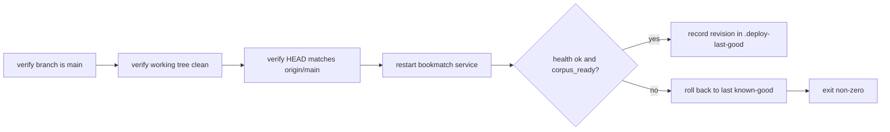

<!-- GENERATED by the doc pipeline — DO NOT EDIT. Hand edits are detected nightly and overwritten. To change this document, change the code or the harvest config (infrastructure/docs/pipeline). -->
[Scope](1_SCOPE_AND_PURPOSE.md) · [System](2_SYSTEM_ARCHITECTURE.md) · **Flows** · [Data](4_DATA_AND_INTEGRATIONS.md) · [Quality](5_QUALITY_AND_OPERATIONS.md) · [Internals](6_INTERNALS.md)

# bookmatch — Workflows

## Workflow: Index build (scripts/build_index.py)

**Trigger:** Manual invocation of `python3 scripts/build_index.py`; one-time multi-GB build from the raw UCSD Goodreads corpus.

**Steps:**
1. Reads `goodreads_interactions.csv`, `book_id_map.csv`, `goodreads_books.json.gz`, and `goodreads_book_authors.json.gz` from the raw directory (`BOOKMATCH_RAW`, default `~/data/goodreads-ucsd/raw`).
2. Reads `goodreads_interactions.csv` in chunks of 20,000,000 rows, filtering to rated interactions (rating in 1..5).
3. Constructs a scipy CSR matrix from the rated user-item pairs and sums duplicate entries.
4. Loads author id to name mappings from `goodreads_book_authors.json.gz`.
5. Loads the remapped book_id to real book_id mapping from `book_id_map.csv`.
6. Creates a SQLite database with books and lookup tables.
7. Streams `goodreads_books.json.gz` and inserts books into SQLite in batches of 50,000.
8. Creates an index on the lookup table's normkey column.
9. Writes `user_item.npz`, `book_lookup.sqlite`, and `meta.json` to the index directory (`BOOKMATCH_INDEX`, default `~/data/goodreads-ucsd/index`).

**Output:** `user_item.npz`, `book_lookup.sqlite`, and `meta.json` in the index directory.

**Failure behavior:** The script is idempotent and rewrites the index directory each run; a failed run can be re-run.

**Diagram:**

## Workflow: Dataset download (scripts/download_dataset.sh)

**Trigger:** Manual invocation of `scripts/download_dataset.sh`; downloads the UCSD Goodreads corpus from `mcauleylab.ucsd.edu`.

**Steps:**
1. Downloads four files — interactions, book_id_map, books, and book_authors — to `~/data/goodreads-ucsd/raw` by default.
2. Uses curl with resume support, retries, and a 2-hour timeout.

**Output:** Four raw corpus files in `~/data/goodreads-ucsd/raw` (gitignored, ~6.5 GB).

**Failure behavior:** UNKNOWN (fact not harvested).

**Diagram:**

## Workflow: Git hook activation (scripts/install_hooks.sh)

**Trigger:** Manual invocation of `scripts/install_hooks.sh`; must be run once per fresh clone.

**Steps:**
1. Sets `core.hooksPath` to `.githooks`.

**Output:** Active git hooks; the ADR-0020 test gate runs on push.

**Failure behavior:** UNKNOWN (fact not harvested).

**Diagram:**

## Workflow: Deploy (deploy.sh)

**Trigger:** Manual invocation of `./deploy.sh` on aurora; deploys the current checkout in place.

**Steps:**
1. Refuses to deploy unless the current branch is `main`.
2. Refuses to deploy if the working tree is dirty.
3. Verifies HEAD matches `origin/main` before deploying.
4. Restarts the `bookmatch` systemd service using `sudo -n`.
5. Checks health by requiring both `ok` and `corpus_ready` from `/api/health`.
6. Records the deployed revision in `.deploy-last-good` on success.
7. Rolls back to the last known-good revision if health checks fail.
8. Exits non-zero even after a successful rollback, marking the deploy as failed.

**Output:** A running `bookmatch` service at the deployed revision; `.deploy-last-good` records the deployed revision on success.

**Failure behavior:** Fail-loud everywhere — no sudo ticket, failed restart, or a dead `/api/health` all abort non-zero. A failed health check rolls back to the last known-good revision and still exits non-zero.

**Diagram:**
